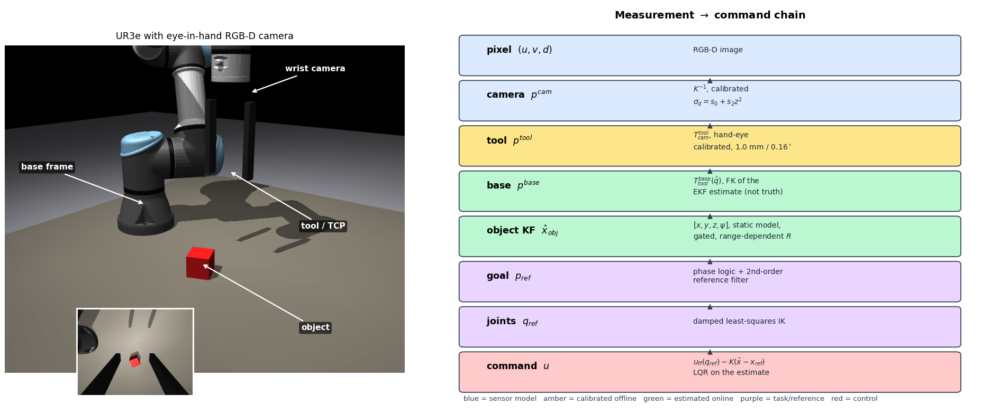
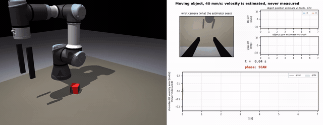
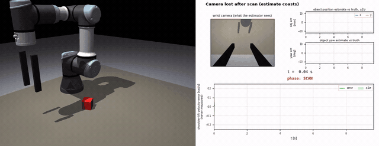
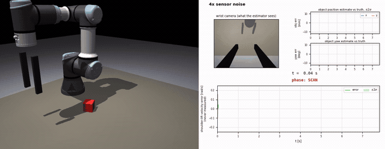
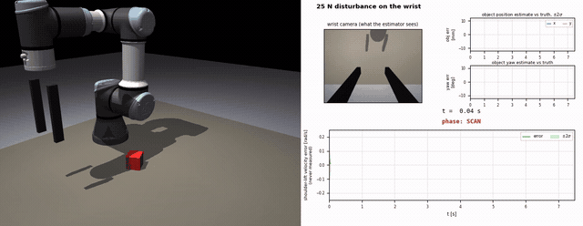
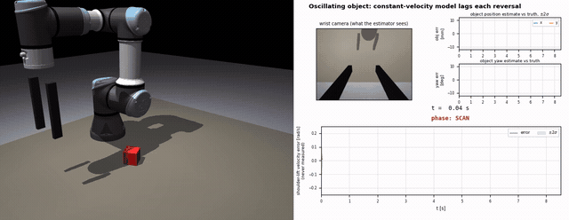
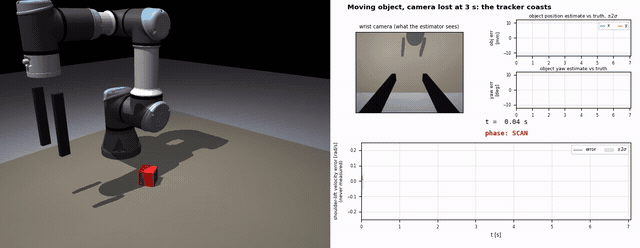

# 41014 Sensors and Control — Assessment 4: Integrated Project

**Track B — vision-guided pick with a UR3e**

| | |
| --- | --- |
| Student | Karan Sharma |
| Student ID | 26276485 |
| Group | 35 |
| Team members | 1 — Karan Sharma (26276485), working solo as a master's student enrolled in 42043 |
| Subject | 41014 Sensors and Control in Mechatronics Systems |
| Platform | UR3e + eye-in-hand RGB-D camera, MuJoCo 3.15, with a real-hardware backend over RTDE |

An eye-in-hand RGB-D camera on a UR3e. The robot searches the table, localises a randomly placed cube —
**static or moving** — and picks it up.

**Every control decision is taken on estimated state.** Joint velocity is never measured. The object pose
comes from a Kalman filter fed by the camera. The simulator's ground truth is used only for evaluation,
and that boundary is enforced mechanically by an AST analysis in `ur3_pick/tests/test_firewall.py` rather
than by inspection.

**Headline result.** On a *static* cube the object filter is nearly redundant. On a cube moving at 40 mm/s,
removing it — or replacing it with a static-object model, or dropping the velocity feed-forward — takes the
pick from **50/50 to 0/50**. Velocity is never measured; it is reconstructed.



**Contents** — [Deliverables checklist](#deliverables-checklist) · [Marking-guide map](#how-this-submission-maps-to-the-marking-guide) ([A](#part-a--modelling--20-marks) · [B](#part-b--sensing--20-marks) · [C](#part-c--estimation--20-marks) · [D](#part-d--control--20-marks) · [E](#part-e--integration-and-robustness--20-marks)) · [Watch it run](#watch-it-run) · [Setup](#setup) · [Simulation](#simulation) · [Hardware](#hardware--running-on-the-real-ur3e) · [Demo video](#demo-video) · [AI declaration](#generative-ai-declaration)

---

## Deliverables checklist

Everything the marking guide asks a marker to confirm, and where it is on this page.

| Deliverable | Where |
|---|---|
| Group number and team members | [top of this page](#41014-sensors-and-control--assessment-4-integrated-project) — Group 35, one member |
| Link to the GitHub repository | this repository; `git clone` instructions under [Setup](#setup) |
| Track stated | Track B, manipulator, vision-guided pick (PBVS) |
| State-space model | [Part A](#part-a--modelling--20-marks) → [technical report §3](ur3_pick/README.md#3-part-a--model) |
| Frame diagram | [`results/fig_frames.png`](ur3_pick/results/fig_frames.png), derivation in [§4](ur3_pick/README.md#4-part-b--sensing-calibration-and-frames) |
| Estimator and controller design **with parameter values** | [Part C](#part-c--estimation--20-marks), [Part D](#part-d--control--20-marks); every value in [`core/control.py`](ur3_pick/core/control.py) `ControllerConfig` |
| Quantitative results | [`docs/RESULTS.md`](ur3_pick/docs/RESULTS.md) — 1350 trials, 27 conditions, Wilson intervals |
| Install and run instructions | [Setup](#setup) and [Simulation](#simulation); `make all` regenerates every number |
| Ground truth used only for evaluation, visible in the code | [`eval/runner.py`](ur3_pick/eval/runner.py) is the only place it appears; enforced by [`tests/test_firewall.py`](ur3_pick/tests/test_firewall.py) |
| Demo video (5 minutes) | see [Demo video](#demo-video) |
| Individual contribution statement | [Contribution statement](#contribution-statement) |
| Generative AI declaration | [stated in full below](#generative-ai-declaration) |

---

## How this submission maps to the marking guide

The marking guide scores five criteria at 20 marks each. The technical report is organised by the same
letters, so each row below leads straight to the section that answers it.

**On the High Distinction band.** The descriptor asks for independent contribution — "a justified extension
of the method, an additional sensor or estimator compared rigorously, a robustness study the brief did not
ask for, or a well-argued account of the limits of the approach" — *including* a working hardware
implementation. Section 1 of the guide says hardware satisfies the independent contribution for **Parts B,
D and E**. It does **not** cover Parts A and C, which therefore carry their own, listed below.

| Part | Criterion | Required by the brief | Independent contribution |
|---|---|---|---|
| **A** | Modelling, observability, controllability | state-space model + rank tests | linearisation validated against MuJoCo's own Jacobian; servo instability diagnosed and fixed |
| **B** | Sensing: calibration, noise, frames | calibration, depth localisation, frame chain | hand-eye error sweep identifying the binding accuracy limit; two detector defects found and fixed |
| **C** | Estimation: KF/EKF, tuning, performance | observer for unmeasured states | constant-velocity object filter with a rigorous ablation; filter over-confidence diagnosed and corrected |
| **D** | Control: design, tuning, tracking | state-space joint controller, PBVS | LQR compared against the servo baseline — including a **negative** result reported honestly |
| **E** | Integration and robustness | randomised object, disturbance and noise | 1350-trial study the brief did not ask for; mechanically enforced ground-truth firewall |

### Part A — Modelling — 20 marks

**Required.** A state-space model of the platform with controllability and observability analysis.

Linearising the inner position servo `τ = k_p(u − q) − k_d q̇` together with the rigid-body dynamics gives a
12-state model in `[q, q̇]`:

```
A = [[0, I], [−M(q)⁻¹(K_p + ∂g/∂q), −M(q)⁻¹K_d]]        B = [[0], [M(q)⁻¹K_p]]
```

discretised by matrix exponential at the 100 Hz control period. Rank tests on the controllability and
observability matrices are in [`scripts/model_analysis.py`](ur3_pick/scripts/model_analysis.py);
construction in [`core/kinematics.py`](ur3_pick/core/kinematics.py) (`linear_model`, `discrete_model`).
Full derivation: [technical report §3](ur3_pick/README.md#3-part-a--model).

**Independent contribution.**

1. **The model is validated, not asserted.** The analytic `A` and `B` are checked numerically against
   MuJoCo's own finite-difference transition Jacobian (`mjd_transitionFD`), so the linearisation is shown
   to match the simulator it is derived from rather than being taken on faith.
2. **A modelling defect found and diagnosed from first principles.** The LQR built on this model diverged
   within 7 control steps. The cause was not the controller: the stock servo damping saturated the joint
   torque limits above ≈0.28 rad/s, so the plant stopped being the linear system the gains were designed
   for. Re-tuning `k_d` to critical damping `2√(k_p·M_ii)` restored agreement and the divergence vanished.
   The edit, and why it was made, are recorded in the model file's header.

### Part B — Sensing — 20 marks

**Required.** Camera calibration, depth-based object localisation, frame management.

Intrinsics from `cv2.calibrateCamera`, hand-eye from `cv2.calibrateHandEye` (Park), both from rendered
images only — never from simulator ground truth. The frame chain is

```
p_base = T_base_tool(q̂) · T_tool_cam · p_cam
```

with `q̂` the *estimated* joint vector, not the true one. Detection is colour segmentation, depth
back-projection and a planar top-face fit. Measurement noise is fitted as `σ² = a + b·range²`, so the
filter's `R` grows with distance. Report: [§4](ur3_pick/README.md#4-part-b--sensing-calibration-and-frames).

**Independent contribution.**

1. **Hand-eye error is the binding accuracy limit, and this is quantified rather than asserted.** Sweeping
   injected calibration error at 5 / 10 / 20 mm shows grasp error tracking it almost one-for-one, and the
   task collapsing to 20 % success at 20 mm as the error passes the jaw capture envelope. No amount of
   filtering removes it, because it is systematic in the frame chain rather than noise — a limit of the
   approach, argued from the data.
2. **Two detector defects found and fixed.** A symmetric 7×5 checkerboard produced a 180° pose ambiguity and
   left-handed rotation matrices, fixed by moving to 7×6 inner corners. A 90th-percentile height estimator
   carried a 6.7 mm bias under 4× noise, fixed by taking the median; the biased version is retained as the
   ablation `abl_p90_height_noise_x4` so the failure is reproducible rather than merely described.

### Part C — Estimation — 20 marks

**Required.** A Kalman filter or observer for the unmeasured states, tuned, with reported performance.

Two estimators, neither of which ever sees ground truth:

* **Joint EKF**, 12 states. Prediction steps the robot's own MuJoCo model with the commanded targets;
  covariance propagates through `mjd_transitionFD`; Joseph-form update. **Joint velocity is never measured**
  — it is reconstructed, which is the observability argument the brief is asking for.
* **Object KF**, 8 states `[x y z yaw]` and their rates, constant-velocity, range-dependent `R`, χ²
  gating at 99.9 % and re-initialisation after 8 consecutive rejections.

Consistency is reported as NEES and NIS, not just error. Tuning grids for `Q` and `R` are in
[`scripts/tuning.py`](ur3_pick/scripts/tuning.py). Report: [§5](ur3_pick/README.md#5-part-c--estimation).

**Independent contribution.**

1. **An additional estimator, compared rigorously.** The constant-velocity object model is compared against
   the static-object model it replaced, under identical conditions. On a static cube the filter is nearly
   redundant. On a cube moving at 40 mm/s, three separate ablations — removing the filter, substituting the
   static model, dropping the velocity feed-forward — each take the pick from **50/50 to 0/50**. The velocity
   that makes the difference is never measured.
2. **Filter over-confidence diagnosed and corrected.** The reported covariance was optimistic because a
   common-mode calibration bias is not averaged away by a Kalman filter, however many frames it sees. The
   fitted bias covariance is now added to the reported `P`, which brings NEES back into its interval. This
   is a correctness argument about what a KF can and cannot do, not a tuning tweak.

### Part D — Control — 20 marks

**Required.** A state-space joint controller, and a pick executed with IBVS or PBVS.

PBVS. A discrete-time LQR solves the DARE on the Part A model, with weights set by Bryson's rule and gains
re-computed every 5 control steps as the configuration changes. A second-order reference filter with
velocity feed-forward generates the trajectory; damped-least-squares IK maps Cartesian goals to joint
targets; a phase machine sequences SCAN → PREGRASP → DESCEND → GRASP → LIFT. Every gain and limit is a
named field of `ControllerConfig` in [`core/control.py`](ur3_pick/core/control.py).
Report: [§6](ur3_pick/README.md#6-part-d--control).

**Independent contribution.**

1. **A negative result, reported honestly.** Against a servo-only baseline the LQR gives **1.7× better joint
   tracking — and no improvement in task success.** The pick is limited by calibration geometry, not by
   tracking error. The marking guide asks for analysis "honest about what the results do and do not
   support"; this is a case where the more sophisticated controller demonstrably did not buy the thing it
   is usually assumed to buy.
2. **A claim retracted on the evidence.** The velocity lead term was initially written up as essential to
   the moving-object pick. The ablation `abl_mov_no_lead` returned 50/50 — identical to nominal — so the
   claim was wrong and the report now says so. A separate over-lead defect (11.6 mm misalignment at
   40 mm/s) was traced to applying the lead during DESCEND and fixed by restricting it to PREGRASP.

### Part E — Integration and robustness — 20 marks

**Required.** The object position randomised between trials, and performance under disturbance and noise.

**1350 Monte Carlo trials across 27 conditions**, with Wilson confidence intervals on every success rate:
detector noise ×2/×4/×8, camera dropout, external forces of 10 N and 25 N, a 0.5 kg payload, injected
hand-eye error, and moving and oscillating objects. Results: [`docs/RESULTS.md`](ur3_pick/docs/RESULTS.md),
discussion in [§8](ur3_pick/README.md#8-part-e--robustness), limits in
[§10](ur3_pick/README.md#10-limits-of-the-approach).

**Independent contribution.**

1. **A robustness study the brief did not ask for**, which is one of the examples the HD descriptor names.
   It is what makes the Part B and Part D findings above quantitative rather than anecdotal.
2. **The no-ground-truth constraint is enforced mechanically, not by inspection.** The brief requires that
   the controller use estimated state. Rather than assert compliance,
   [`tests/test_firewall.py`](ur3_pick/tests/test_firewall.py) walks the abstract syntax tree of the control
   path and fails the build if any simulator handle reaches it, and separately proves the controller is
   backend-agnostic by driving it with a duck-typed observation. Seven tests; a reviewer can verify the
   constraint by running `make test` rather than by reading every line.

### Hardware — status stated plainly

The HD band expects a working implementation on real hardware. The honest position:

**Written and verified** — the RTDE/RealSense/gripper backend, a safety limiter on every command, a
`HardwarePlant` that presents the simulator's exact interface and deliberately has **no** ground-truth
attribute, dependencies installed and importing, and an interface test proving the controller runs
unmodified on either backend. A seven-stage bring-up procedure is written, and the gripper is probed rather
than assumed.

**Not yet done** — none of it has driven a robot. The `servoJ` timing loop, the real hand-eye transform,
the gripper handshake and the camera's minimum range are all untested against hardware. Detail and the
stage that closes each one: [Honest status](#honest-status).

Parts A and C above do not depend on this, by the marking guide's own division.

---

## Watch it run

Left half of each clip is the scene; right half is what the estimator sees — wrist camera, object estimate
against truth with its ±2σ band, and the shoulder-lift velocity that is **never measured**.

### The headline: the same moving cube, with and without a velocity model

| Constant-velocity object filter — **50/50** | Static-object model instead — **0/50** |
|---|---|
|  |  |
| The filter reconstructs the cube's velocity from position measurements alone and the controller leads the target. | Identical code, one changed process model. The estimate lags behind the cube and the gripper closes on empty table. |

### Nominal pick, static cube


### Robustness

| Condition | |
|---|---|
| **Camera dropout** — frames cut for 1 s mid-approach; the filter coasts on its own prediction |  |
| **4× detector noise** |  |
| **25 N external force** applied to the arm |  |
| **Oscillating object** |  |
| **Moving object + camera dropout** together |  |

<sub>These are GIFs because GitHub will not play an mp4 that lives in a repository — only files uploaded
through its web UI get a player. The original H.264 renders are in
[`ur3_pick/results/video/`](ur3_pick/results/video/) at full 1240×480; regenerate the GIFs with
`make gifs`.</sub>

---

## Repository layout

```
ur3_pick/            the project
├── README.md        FULL technical report — model, sensing, estimation, control, results
├── sim/             MJCF scene assembly, plant, sensors, disturbances, ground truth
├── core/            kinematics, sensing/calibration, EKF + object KF, controller
├── eval/            trial runner — the only place estimates meet ground truth
├── hardware/        real UR3e backend: RTDE, RealSense, gripper, safety limiter
├── scripts/         experiments (sim) and the hw_* bring-up sequence (real robot)
├── tests/           ground-truth + backend-agnosticism firewall (7 tests)
├── configs/         calibration, noise model, segmentation, hardware settings
├── docs/            hardware bring-up, viva prep, video script, AI declaration
└── results/         every figure, Monte Carlo log and video in the report
```

Start with **[`ur3_pick/README.md`](ur3_pick/README.md)** — that is the real report. This page is the front
door and the command reference.

---

## Setup

```bash
git clone https://github.com/karanS08/42043_Robotics_Studio_1.git
cd 42043_Robotics_Studio_1

python3 -m venv .venv
.venv/bin/pip install -r ur3_pick/requirements.txt
export MUJOCO_GL=egl            # or osmesa for software rendering
```

### Third-party model

The UR3e description comes from
[SouthColumn76/universal_robots_ur3e](https://github.com/SouthColumn76/universal_robots_ur3e), originally
ROS Industrial Consortium, **BSD-3-Clause**. The MJCF and its 20 collision/visual meshes are vendored into
`ur3_pick/model/` so this repository is self-contained — clone it and it runs, with no second clone and no
dangling symlink. The licence is redistributed verbatim as
[`ur3_pick/model/LICENSE_ur3e.txt`](ur3_pick/model/LICENSE_ur3e.txt), as clause 1 requires.

`ur3_pick/model/ur3e.xml` carries exactly **two documented edits**, both recorded in a header comment in
the file itself:

1. the keyframe was removed, so the scene can add free bodies;
2. the servo damping `biasprm[2]` was retuned `200/100/40 → 42/24/9` to critical damping — the stock values
   saturated the torque limits above ~0.28 rad/s and invalidated the linearisation the LQR is built on.

---

## Simulation

All commands run from `ur3_pick/`.

```bash
cd ur3_pick

.venv/bin/python scripts/run_one.py 0        # one pick, prints every metric
.venv/bin/python scripts/demo.py             # live MuJoCo viewer (needs a display)
make test                                    # the 7 firewall tests
make all                                     # regenerate every number and figure in the report
```

`make all` runs calibration → noise characterisation → model analysis → tuning → 1350 Monte Carlo trials →
plots → report. About 9 minutes on 8 workers.

**Memory cap.** MuJoCo is heavy and long runs previously OOM-killed this laptop. Every heavy job goes
through `scripts/capped.sh`, which runs it inside a `systemd-run` scope with a hard `MemoryMax` and swap
disabled:

```bash
bash scripts/capped.sh --mem 4G .venv/bin/python scripts/monte_carlo.py 50
```

The Makefile already applies a 5 GB cap at 8 workers. RSS stays flat at ~466 MB per worker.

---

## Hardware — running on the real UR3e

Full detail, including what each check means and what to do when it fails:
**[`ur3_pick/docs/hardware_bringup.md`](ur3_pick/docs/hardware_bringup.md)**.

### Before you start

On the teach pendant: power on, release the brakes, set the robot to **Remote Control** mode. Read the IP
from *Settings → System → Network*. The PC must be on the same subnet.

`configs/hardware.json` already has `"camera": "realsense"`. **The gripper does not need to be known in
advance** — stage 1 probes for it. The only thing to supply is the IP.

```bash
cd ur3_pick
.venv/bin/pip install -r requirements-hw.txt     # ur_rtde + pyrealsense2 (prebuilt wheels, no compile)
export IP=192.168.1.102                          # <- your robot's address
```

### The sequence

Run these **in order**. The "moves" column is the one to read before pressing enter.

| # | Command | Moves? | What it does |
|---|---|---|---|
| 1 | `make hw-check IP=$IP` | **no** | Ping, RTDE ports, robot/safety mode, joint reads, FK vs the robot's own TCP, **gripper probe**, camera frame rate and depth coverage, calibration provenance. Writes `configs/hardware.json`. |
| 2 | `make hw-identify IP=$IP` | **yes** — small steps | Identifies the inner position-servo gains `k_p`, `k_d` from step responses, so the controller's feed-forward matches this robot instead of the simulator. |
| 3 | `make hw-calib IP=$IP` | no (freedrive by hand) | Intrinsics + hand-eye from a 7×6-inner-corner checkerboard. **Targets: reprojection RMS < 0.5 px, hand-eye spread < 5 mm.** |
| 3b | `make hw-segment IP=$IP` | **no** | Fits the cube's colour thresholds to the lab lighting from the camera's own frames. |
| 3c | `make hw-noise IP=$IP` | **yes** — moves between poses | Measures this camera's real detection noise, fits `σ² = a + b·range²`, writes the object filter's `R`. |
| 4 | `make hw-dry IP=$IP` | **no** | **The whole pipeline, no motion.** Camera, detector, both filters, controller — prints the commands it *would* send. The control interface is never opened. |
| 5 | `make hw-run IP=$IP` | **yes** — the pick | Blocking `moveJ` home, then 100 Hz servo. Prompts for confirmation. Logs to `results/hw_<timestamp>.npz`. |
| 6 | `make hw-compare LOG=results/hw_<timestamp>.npz` | no | Sim vs hardware figure and table. |

Budget a full session for stages 1–3c before expecting a pick.

### Reading stage 4 before you let it move

The dry run is the gate. Check all four:

- the object is detected from the scan pose — not `(no detection)`,
- the estimated position is physically sensible in the base frame,
- for a moving object, the estimated speed matches reality,
- `|u − q|` stays small — a large residual means the controller is fighting the model.

### Safety

Every command passes `hardware/safety.py` before reaching the robot: joint limits, per-step and per-second
speed caps, a TCP bounding box, and a maximum tracking error. Any violation calls `servoStop` and raises
`SafetyAbort`. Hardware defaults are deliberately slower than simulation — `--v-max 0.08` against 0.25 m/s.

`HardwarePlant` has **no `.truth` attribute**, so any code that reaches for ground truth on real hardware
fails loudly instead of silently reading nothing.

### Honest status

The hardware backend is written, its dependencies install and import, and it is interface-checked against
the simulator by the test suite — but **it has not yet been validated against a robot**. What is still
untested, and the stage that closes each:

| Untested | Risk | Closed by |
|---|---|---|
| `servoJ` 100 Hz timing loop | Real network and controller cycle | Stage 4 |
| Hand-eye transform | Physical mount unknown; grasp error tracks this error 1:1 | Stage 3 |
| Colour thresholds | Lab lighting ≠ sim lighting | Stage 3b |
| Gripper handshake | Model unconfirmed; stage 1 probes for it | Stages 1, 5 |
| RealSense minimum range | ~0.2 m typical vs a 0.10 m pre-grasp hover | Stage 4 |
| Servo gains | Default to the simulator's values | Stage 2 |

---

## Documentation

| Document | What it covers |
|---|---|
| [`ur3_pick/README.md`](ur3_pick/README.md) | The full report: model, sensing, estimation, control, failure analysis, robustness |
| [`ur3_pick/docs/RESULTS.md`](ur3_pick/docs/RESULTS.md) | Generated results tables |
| [`ur3_pick/docs/hardware_bringup.md`](ur3_pick/docs/hardware_bringup.md) | Stage-by-stage hardware procedure |
| [`ur3_pick/docs/video_script.md`](ur3_pick/docs/video_script.md) | 5-minute video script |
| [`ur3_pick/docs/AI_declaration.md`](ur3_pick/docs/AI_declaration.md) | Generative-AI use declaration |
| [`ur3_pick/docs/acknowledgements.md`](ur3_pick/docs/acknowledgements.md) | Third-party material |

## Demo video

**5-minute demonstration:** `<!-- TODO: paste the video link here before submitting -->`

Covers what the marking guide requires of it: the system completing the task, at least one varied or
disturbed trial, and the estimate with its uncertainty shown alongside the true state. The clips under
[Watch it run](#watch-it-run) are the same renders — each shows the object estimate against truth with its
±2σ band, and the shoulder-lift velocity that is never measured. Script:
[`docs/video_script.md`](ur3_pick/docs/video_script.md).

---

## Contribution statement

**Group 35. One member: Karan Sharma (26276485).**

Solo project — a master's student enrolled in 42043, for which the permitted group size is 1–2. All
modelling, implementation, experiments, analysis and documentation are the author's own work. Third-party
material is listed in [`ur3_pick/docs/acknowledgements.md`](ur3_pick/docs/acknowledgements.md).

## Generative AI declaration

**Tool.** Claude (Anthropic), used through Claude Code in the terminal.

**Purpose and extent.** Used as a pair programmer and reviewer throughout and drafting the text of this project page.

**Not delegated.** The choice of track and scope, the modelling assumptions, which quantities to measure,
the acceptance criteria for each part, and the interpretation of the results are the author's own.

**Verification.** Every number quoted on this page is produced by the scripts in this repository and can be
regenerated with `make all`; no result was taken from the assistant's description of a result. Generated
code was executed and checked against simulator ground truth (`eval/`), against analytic expectations
(`scripts/model_analysis.py`), and against filter-consistency statistics (NEES/NIS). The ground-truth
firewall is enforced mechanically by `tests/test_firewall.py` rather than by inspection.

Full statement: [`docs/AI_declaration.md`](ur3_pick/docs/AI_declaration.md).
