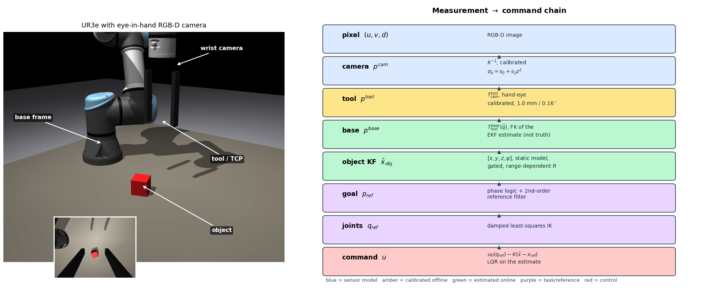
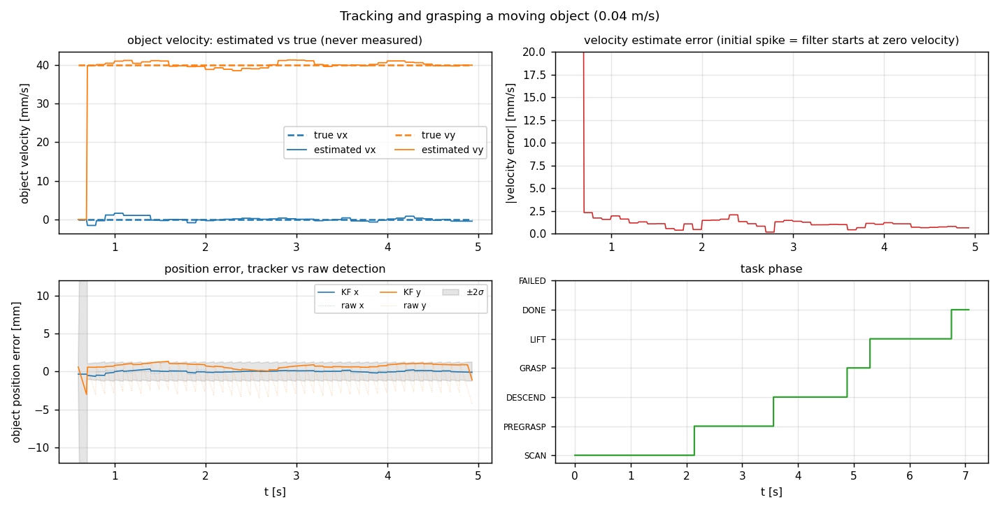
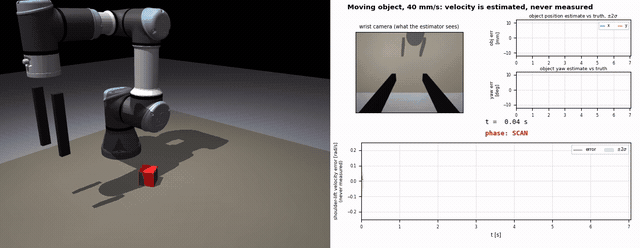
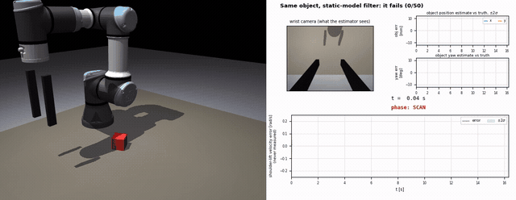

# 41014 Assessment 4 — Track B: vision-guided pick with a UR3e

Eye-in-hand RGB-D camera on a UR3e in MuJoCo. The robot searches the table, localises a randomly placed
cube — **static or moving** — and picks it up. **Every control decision is taken on estimated state**: joint velocity is never
measured, the object pose comes from a Kalman filter fed by the camera, and the simulator's ground truth is
used only for evaluation — enforced mechanically by `tests/test_firewall.py`, not by inspection.

| | |
| --- | --- |
| Track | B — manipulator, vision-guided pick (PBVS) |
| Platform | UR3e in MuJoCo 3.15, wrist RGB-D camera (320×240, 70° fovy, 10 Hz), two-finger gripper |
| Control rate | 100 Hz; physics 500 Hz |
| Randomisation | cube x ∈ [0.18, 0.27] m, y ∈ [−0.20, 0.20] m, yaw ∈ [−45°, 45°] |
| Object | static, or **moving** (conveyor-style, 20–100 mm/s, or oscillating) |



**Headline result.** On a *static* cube the object filter is nearly redundant. On a cube moving at
40 mm/s, removing it — or replacing it with the static-object model, or dropping the velocity
feed-forward — takes the pick from **50/50 to 0/50**. Velocity is never measured; it is reconstructed.



The same cube, moving at the same speed, with the only difference being the filter's process model:

| Constant-velocity model — **50/50** | Static-object model — **0/50** |
|---|---|
|  |  |

Left half of each clip is the scene, right half is what the estimator sees: wrist camera, object estimate
against truth with its ±2σ band, and the shoulder-lift velocity that is never measured. More clips, including
camera dropout and the disturbance cases, are on the [project page](../README.md#watch-it-run); the full-size
H.264 renders are in [`results/video/`](results/video/).

## 1. Quick start

```bash
python3 -m venv .venv && .venv/bin/pip install -r requirements.txt
export MUJOCO_GL=egl                      # or osmesa for software rendering
.venv/bin/python scripts/run_one.py 0     # one pick, prints the metrics
```

Reproduce every number and figure on this page, in order (about 12 minutes on 8 cores):

```bash
scripts/capped.sh --mem 5G .venv/bin/python scripts/calibrate.py           # -> configs/calibration.json
scripts/capped.sh --mem 5G .venv/bin/python scripts/characterise_noise.py  # -> configs/noise_model.json
scripts/capped.sh --mem 5G .venv/bin/python scripts/model_analysis.py      # -> Part A tables + validation
UR3_WORKERS=8 scripts/capped.sh --mem 5G .venv/bin/python scripts/tuning.py 15
UR3_WORKERS=8 scripts/capped.sh --mem 5G .venv/bin/python scripts/monte_carlo.py 50
.venv/bin/python scripts/make_plots.py && .venv/bin/python scripts/make_report.py
.venv/bin/python -m pytest                # ground-truth firewall
```

`scripts/capped.sh` runs a job inside a memory-capped systemd scope, so a runaway sweep is killed instead of
the machine. Results land in `results/`, the generated tables in [`docs/RESULTS.md`](docs/RESULTS.md).

## 2. Pipeline

```
RGB-D (10 Hz) ─► colour segmentation ─► depth back-projection ─► object KF [x y z ψ ẋ ẏ ż ψ̇] ─┐
                                             ▲                                        │
encoders (100 Hz) ─► joint EKF ─► q̂, q̂̇ ─────┘ FK + hand-eye                          ▼
                       │                                            phase logic → reference filter
                       │                                                     │
                       └──────────────► LQR:  u = u_ff(q_ref) − K(x̂ − x_ref) ◄── DLS IK
```

Five phases: `SCAN → PREGRASP → DESCEND → GRASP → LIFT`. Every transition condition is evaluated on
estimated quantities. The first scan pose sees the whole workspace; if nothing is detected within 1 s the
controller moves to a second pose, which is what makes cubes at the far edge of the table reachable.

## 3. Part A — model

With the UR3e's inner position servo closed (`τ = k_p(u − q) − k_d q̇`), the plant from position **targets**
`u` to joint state is, linearised about `(q, q̇ = 0)`:

```
M(q) q̈ + c(q,q̇) + g(q) = k_p(u − q) − k_d q̇

x = [q − q₀, q̇]       A = [[0, I], [−M⁻¹(K_p + ∂g/∂q), −M⁻¹K_d]]
u = targets − u_eq     B = [[0], [M⁻¹K_p]]          C = [I, 0]   (encoders only)
```

`M(q)` is taken from the MJCF inertial parameters (including rotor armature), `∂g/∂q` by central differences.
The model is discretised exactly (zero-order hold, `expm`) at 100 Hz.

**Assumptions**, each checked or bounded: rigid links; no joint friction beyond the servo's `k_d`; Coriolis
terms dropped (they vanish at `q̇ = 0`, and the robot moves at ≤ 0.25 m/s); torque saturation outside the
linear model (±56/28/12 N·m — the reason the stock damping had to be retuned, §7); the object is static.

**Controllability and observability** (rank + smallest singular value, at three configurations — see
[`docs/RESULTS.md`](docs/RESULTS.md)): both matrices have full rank 12 everywhere, with
σ_min(ctrb) ≈ 0.32 and σ_min(obsv) ≈ 4×10⁻³. Velocity is observable from position alone because the servo
stiffness couples the two blocks. **With a single encoder the rank drops to 8–9 of 12**, which is the concrete
answer to "which states are observable from which sensors".

Validation against the full nonlinear MuJoCo model, relative RMS error over a 0.6 s step response:
**0.13 %** for a 0.02 rad step, **2.0 %** for a 0.3 rad step (`results/model_validation.png`).

## 4. Part B — sensing, calibration and frames

Chain from pixel to the quantity the controller acts on:

```
p_base = T_base_tool(q̂) · T_tool_cam · K⁻¹ · (u, v, d)
          └ FK of the EKF    └ hand-eye   └ intrinsics
             estimate            calibrated   calibrated
```

* **Intrinsics** — 40 checkerboard views (7×6 inner corners, 25 mm). Pinhole with square pixels and the
  principal point fixed at the image centre, distortion fixed at zero, because that is what the sensor
  actually is; estimating free distortion coefficients only fits noise. Reprojection RMS **0.19 px**,
  focal-length error **+0.40 px** against the simulator's true value.
* **Hand-eye** — `cv2.calibrateHandEye` (Park). Translation error **1.03 mm**, rotation **0.16°**.
  An 8×7-square board is used deliberately: a symmetric board gives a 180° pose ambiguity, which produced
  left-handed rotation matrices on the first attempt.
* **Noise** — characterised empirically over 70 poses × 15 frames, then split into a **white** part (varies
  frame to frame at a fixed pose) and a **bias** part (varies with viewpoint, so averaging cannot remove it).
  Variances are fitted as `a + b·r²` against camera-object range `r`; at a typical 0.3 m working range the
  white part is ≈0.14 mm in x/y and the bias is **0.50 mm in x/y, 0.89 mm in z, 0.45°**
  ([`docs/RESULTS.md`](docs/RESULTS.md)). The bias dominates, which is why filtering helps yaw far more than
  position (§5), and it is what the object filter's covariance must include.
* **Rejection rules** — a detection touching the image border is discarded (a clipped blob biases the
  centroid), and the cube's top face is found by the median height rather than the 90th percentile (§7).

## 5. Part C — estimation

**Joint EKF** (12 states). Prediction uses the robot's *own* MuJoCo model stepped with the commanded targets,
with the covariance propagated through `mjd_transitionFD`; the measurement is the encoder vector, so velocity
is never measured. Process noise is a constant-acceleration model with σ_a; `R = σ_enc² I`, σ_enc = 1 mrad.

Choosing σ_a is a genuine trade-off, and the sweep shows why a nominally optimal value is the wrong choice:

| σ_a [rad/s²] | NEES nominal | NEES +0.5 kg payload | NEES +25 N push | q̇ RMSE [mrad/s] |
| --- | --- | --- | --- | --- |
| 0.2 | **12.7** (ideal) | 3307 | 2095 | 1.1 |
| 2.0 **(chosen)** | 2.4 | 15.4 | 13.2 | 4.5 |
| 5.0 | 4.3 | 5.2 | 5.1 | 15.4 |

Target is E[NEES] = 12. Tuning on the nominal plant (σ_a = 0.2) gives a filter that is *two orders of
magnitude* inconsistent as soon as there is an unmodelled payload or an external push. σ_a = 2 keeps NEES
within a factor of ~5 of the target across all three plants while keeping the velocity estimate four times
sharper than σ_a = 5. It is deliberately conservative in the nominal case.

**Object KF** — 4 states `[x, y, z, ψ]`, static-object model, range-dependent `R` from §4, Mahalanobis gate at
99.9 % with re-initialisation after 8 consecutive rejections (so a wrong lock cannot persist). The reported
covariance adds the viewpoint bias: for a static state the Kalman gains sum to one, so a common-mode error
passes straight through to the estimate and `P_white` alone would be over-confident.

A consequence worth stating: with `P₀ = R`, the estimate of a static state is **invariant to a uniform
scaling of R** — it is the sample mean either way. Scaling the assumed camera R over four orders of magnitude
moves the error at grasp only from 1.34 mm to 1.26 mm; what changes is the reported uncertainty (object NEES
1.00 → 0.43). So "tune R" is the wrong instinct here: what matters is the *ratio* of R to the process noise,
and for a static object that ratio is fixed.

**Does the object filter actually help? It depends entirely on whether the object moves.**

*Static object* — almost not at all:

| | raw detection | object KF |
| --- | --- | --- |
| xy error at grasp, nominal | 0.89 mm | 0.88 mm |
| xy error at grasp, ×4 noise | 1.34 mm | 1.33 mm |
| success | 100 % | 100 % |

The residual position error is dominated by the *viewpoint bias and hand-eye error*, which are common-mode:
averaging cannot remove them. The filter earns its place only in **yaw**, where the single-frame estimate
from `minAreaRect` spikes by ±15° under noise against ±1° filtered, and in **outlier rejection** (the gate
discards ~62 bad detections per trial at ×8 noise).

*Moving object* — the filter becomes **necessary**, which is the point of the whole estimation chapter:

| object at 40 mm/s | success | velocity RMSE |
| --- | --- | --- |
| **constant-velocity tracker** | **100 %** | 5.5 mm/s |
| static-object filter (same code, process model says the object cannot move) | **0 %** | 38.8 mm/s |
| no filter, raw detections only | **0 %** | — |

With a static target the Kalman filter is an averager and a cheap alternative would do. With a moving target
it has to **predict**: the camera runs at 10 Hz, the controller at 100 Hz, so nine control steps in every ten
are driven by the process model alone, and the jaws can only capture the object if the tool matches its
velocity to within 50 mm/s. Velocity is never measured — it is reconstructed from a sequence of noisy
position measurements, exactly like the joint velocities in the arm's own EKF.

Consistency across conditions (object NEES, expected 4): 5.2 nominal, 14.7 at ×4 noise, 244 at ×8 noise,
158–2287 for the hand-eye-error conditions. The filter is close to consistent when its noise assumptions hold
and becomes **over-confident exactly when they do not** — a filter cannot know about noise it was not told
about, or about a systematic error in its own frame chain. The same pattern appears in the joint EKF
(NEES 2.4 nominal, 37.7 when the true encoder noise is 4× the assumed value).

### Tracking a moving object

The object filter is a constant-velocity Kalman filter on `[x, y, z, ψ, ẋ, ẏ, ż, ψ̇]`:

```
F = [[I₄, Δt·I₄], [0, I₄]]      H = [I₄, 0]      Q = piecewise white acceleration (σ_a = 0.35 m/s²)
```

prediction every control step (100 Hz), correction only when a camera frame arrives (10 Hz), so nine control
steps in ten are driven by the process model alone.

Three changes to the controller were needed for interception. The ablations say which of them actually
matter, and one of my initial assumptions was wrong:

| ablation at 40 mm/s | success |
| --- | --- |
| full controller | **100 %** |
| no velocity feed-forward in the reference filter | **0 %** |
| no object filter, raw detections | **0 %** |
| static-object process model | **0 %** |
| no lead term on approach (`lead_time = 0`) | **100 %** |

1. **Velocity feed-forward is essential.** `a = ω²(goal − p) + 2ω(v_goal − v)`. Without the feed-forward
   term a critically damped second-order filter tracking a ramp settles with a lag of `2v/ω` — 16 mm at
   40 mm/s with ω = 5 rad/s, far beyond the grasp tolerance. This ablation fails every trial.
2. **Velocity matching before the jaws close.** The transition into GRASP requires the estimated tool-object
   speed mismatch to be under 5 mm/s, because the plant's capture model rejects a grasp whose relative speed
   exceeds 50 mm/s — jaws closing on an object sliding past knock it away.
3. **The lead term turned out not to matter.** Aiming at `p̂ + v̂·t_lead` on approach is intuitive, but
   removing it changes nothing at these speeds, because the velocity feed-forward already drives the tool
   onto the object's trajectory before the descent begins. It is kept because it shortens the approach
   slightly, but the honest statement is that it is not what makes the pick work. Leaving the lead on
   *during* the descent is actively harmful: it puts the jaws `t_lead × speed` ahead of the cube, which cost
   11.6 mm of alignment error at 40 mm/s before it was fixed.

**Process noise is a real trade-off** (15 trials per cell). σ_a is the assumed object acceleration:

| σ_a [m/s²] | static + camera loss | moving | moving + camera loss | oscillating |
| --- | --- | --- | --- | --- |
| 0.02 | 100 % | 100 % | 100 % | **93 %** |
| **0.05 (chosen)** | 93 % | 100 % | 100 % | 100 % |
| 0.20 | 67 % | 100 % | 100 % | 100 % |
| 0.80 | **20 %** | 100 % | 93 % | 100 % |

A large σ_a lets the filter believe in velocity it has not really seen. On a *static* object that velocity
estimate is pure noise, and when the camera is lost the filter integrates it into a drifting position — 20 %
success at σ_a = 0.8. Too small and the filter cannot follow the genuine acceleration of the oscillating
object. σ_a = 0.05 m/s² is the knee, and this is the cost of using one tracker for both cases: a static
object is served better by a smaller σ_a than a manoeuvring one.

**Capability limit** (15 trials per point, `results/fig_speed_limit.png`):

| object speed [mm/s] | 0 | 20 | 40 | 50 | 60 | 70 | 80 | 100 |
| --- | --- | --- | --- | --- | --- | --- | --- | --- |
| constant-velocity tracker | 100 % | 100 % | 100 % | 93 % | 87 % | 67 % | 27 % | 0 % |
| static-object filter | 100 % | 0 % | 0 % | 0 % | 0 % | 0 % | 0 % | 0 % |
| velocity RMSE [mm/s] | 1.3 | 2.7 | 4.9 | 6.1 | 7.4 | 9.1 | 11.3 | 16.1 |

The static-object filter fails from 20 mm/s upward — the slowest motion tested. The constant-velocity
tracker holds to 50 mm/s and degrades to nothing by 100 mm/s, but note the velocity RMSE stays small
throughout: the failures above 50 mm/s are **not** tracking failures. The object crosses the 0.4 m of
reachable workspace before the arm can acquire it, approach and match speed, so this is a workspace and
cycle-time limit. The honest statement is that the estimator is not the bottleneck there; the reach is.

Where the model breaks: the constant-velocity assumption is wrong at every turning point of the
oscillating-object case, and the estimate visibly lags through each reversal. It still succeeds
(`oscillating` condition) because the reversals happen away from the grasp, but a target that accelerated
during the descent would need an acceleration state or an IMM filter.

## 6. Part D — control

```
u = u_ff(q_ref, q̇_ref, q̈_ref) − K(x̂ − x_ref)
u_ff = q_ref + (M q̈_ref + c + g + k_d q̇_ref)/k_p      (inverts the servo + rigid-body model)
```

`K` is a discrete LQR gain, recomputed every 5 steps from the analytic linearisation **about the current
estimate** (gain scheduling). Weights follow Bryson's rule, `Q_q = 1/q_max²`, `R = 1/u_max²`. Cartesian goals
pass through a critically damped second-order reference filter (ω = 5 rad/s, 0.25 m/s limit) and
damped-least-squares IK, so a jump in the object estimate can never become a step in the joint reference.

| weights (q_max / u_max) | Cartesian RMSE [mm] | joint RMSE [mrad] | RMS torque [N·m] | chatter [mrad/step] | success |
| --- | --- | --- | --- | --- | --- |
| servo only, no LQR | 1.18 | 2.09 | 2.95 | 4.9 | 100 % |
| 0.02 / 0.004 | 1.17 | 2.06 | 2.96 | 4.9 | 100 % |
| 0.02 / 0.1 | 0.75 | 0.95 | 3.01 | 5.0 | 100 % |
| **0.005 / 0.02 (chosen)** | **0.70** | **0.78** | **3.02** | **5.0** | **100 %** |
| 0.005 / 0.1 | 0.59 | 0.51 | 3.19 | 5.8 | 100 % |
| 0.001 / 0.02 | 0.57 | 0.47 | 3.24 | 6.2 | **93 %** (1 trial diverged) |
| 0.001 / 0.1 | 0.56 | 0.46 | 3.67 | 10.1 | 100 % |

LQR cuts the Cartesian tracking error **1.7×** against the inner servo alone (1.18 → 0.70 mm) for 2 % more
torque. The sweep is a clean Pareto front (`results/fig_tuning_control.png`): the last 0.14 mm of tracking
costs 22 % more torque and doubles the command activity, and the most aggressive setting diverged (NaN) in
1 of 15 trials. The chosen point sits at the knee, just inside that limit.

Three things bound the gain: the ±56/28/12 N·m torque limits, which lie *outside* the linear model the gain
is designed from; the 100 Hz sample rate; and the fact that the feedback acts on an **estimate**, so a higher
gain amplifies estimation error. The estimator's quality therefore caps the usable controller bandwidth —
defect #1 in §7 is this failure mode in its extreme form.

## 7. Failure analysis

Four defects found during development; each is traced to a component and reproducible.

| # | Symptom | Cause | Component | Fix | Evidence |
| --- | --- | --- | --- | --- | --- |
| 1 | LQR diverged within 7 steps; torques railed | Stock servo damping (`k_d` 200/100/40) saturates the ±56/28/12 N·m torque limits above ≈0.28 rad/s, so the linearisation the gain is computed from is invalid | model / control | retuned `k_d` to critical, `2√(k_p M_ii)` = 42/24/9; LQR moved onto the analytic model | `model/ur3e.xml` header, §3 |
| 2 | Yaw estimate off by 41°; filter rejected every update | Detector locked onto the red TCP marker, and cubes clipped by the image border gave a biased centroid | sensing | marker made invisible; detections touching the border rejected | `core/sensing.py` |
| 3 | 6.7 mm height bias under 4× noise | Cube top face estimated by the 90th percentile of back-projected heights — a biased statistic once depth noise grows | sensing | median instead; old version kept as the `abl_p90_height_noise_x4` ablation | ablation row in [`docs/RESULTS.md`](docs/RESULTS.md) |
| 4 | Object KF over-confident, NEES ≫ 4 | Only white noise was modelled; the viewpoint-dependent bias does not average out of a static-state filter | estimation | bias covariance added to the reported `P` | §5 |

## 8. Part E — robustness

50 randomised trials per condition, **1350 in total** (520 s on 8 cores). Full tables in
[`docs/RESULTS.md`](docs/RESULTS.md); figures `results/fig_robustness.png` and `results/fig_speed_limit.png`.

| condition | success (95 % CI) | grasp error, median / p95 |
| --- | --- | --- |
| nominal (static) | 50/50 (93–100 %) | 1.07 / 1.24 mm |
| sensor noise ×2 | 50/50 (93–100 %) | 1.08 / 1.41 mm |
| sensor noise ×4 | 50/50 (93–100 %) | 1.59 / 2.30 mm |
| sensor noise ×8 | 45/50 (79–96 %) | 4.05 / 5.84 mm |
| camera lost after scan | 48/50 (87–99 %) | 6.92 / 10.58 mm |
| 10 N push on the wrist | 50/50 (93–100 %) | 1.09 / 1.60 mm |
| 25 N push on the wrist | 50/50 (93–100 %) | 1.11 / 2.84 mm |
| 0.5 kg unmodelled payload | 50/50 (93–100 %) | 1.15 / 1.45 mm |
| hand-eye error 5 mm / 1° | 50/50 (93–100 %) | 5.24 / 6.81 mm |
| hand-eye error 10 mm / 2° | 49/50 (90–100 %) | 10.67 / 13.14 mm |
| **hand-eye error 20 mm / 4°** | **10/50 (11–33 %)** | 21.37 / 29.34 mm |
| **moving object, 20 mm/s** | 50/50 (93–100 %) | 1.12 / 1.41 mm |
| **moving object, 40 mm/s** | 50/50 (93–100 %) | 1.18 / 1.58 mm |
| **moving object, 60 mm/s** | 34/50 (54–79 %) | 1.50 / 1.96 mm |
| **oscillating object** | 50/50 (93–100 %) | 1.17 / 3.26 mm |
| moving + ×4 noise | 46/50 (81–97 %) | 1.50 / 2.30 mm |
| moving + camera lost at 3 s | 50/50 (93–100 %) | 2.92 / 4.49 mm |
| moving + 25 N push | 50/50 (93–100 %) | 1.28 / 2.73 mm |
| *abl:* no LQR (servo only) | 50/50 (93–100 %) | 1.09 / 1.23 mm |
| *abl:* no object KF (static) | 50/50 (93–100 %) | 0.89 / 1.03 mm |
| *abl:* no object KF, ×4 noise | 50/50 (93–100 %) | 1.38 / 1.86 mm |
| *abl:* biased height estimator, ×4 noise | 48/50 (87–99 %) | 6.42 / 7.57 mm |
| ***abl:* moving, static-model filter** | **0/50 (0–7 %)** | — |
| ***abl:* moving, no object filter** | **0/50 (0–7 %)** | — |
| ***abl:* moving, no velocity feed-forward** | **0/50 (0–7 %)** | — |
| *abl:* moving, no lead term | 50/50 (93–100 %) | 1.11 / 1.59 mm |

**What the numbers say.**

* **The estimator is what makes the moving-object pick work.** Three separate ablations — static process
  model, no filter at all, no velocity feed-forward — each give **0/50** on an object moving at 40 mm/s,
  while the full pipeline gives 50/50. On a *static* object the same filter is nearly redundant (50/50
  either way). That contrast is the clearest evidence in the project that the estimation stage is
  load-bearing rather than decorative.
* **Calibration error is the binding limit.** Grasp error tracks hand-eye error almost one-for-one
  (5 mm → 5.2 mm, 10 mm → 10.7 mm, 20 mm → 21.4 mm) and the task collapses to 20 % once it exceeds the jaw
  capture envelope (≈15 mm). No amount of filtering helps: it is a systematic error in the frame chain, not
  noise. This is the result that transfers directly to the real robot.
* **Disturbance and payload are not limiting.** A 25 N push and a 0.5 kg unmodelled payload leave the
  success rate untouched, because each phase waits for the reference to settle. They show up in the
  estimator instead (joint NEES 2.4 → 12.2 and 15.6), which is the right place to look for them.
* **Object speed has a hard ceiling** at about 50 mm/s, and the reason is reach, not tracking: the velocity
  estimate stays accurate to ~6 mm/s, but the object crosses the workspace before the arm can intercept it.
* **Camera loss is survivable in both regimes**, but for different reasons — a static object simply stops
  being updated, while a moving one is carried forward by the velocity state. The static case is now
  slightly *worse* (48/50, 6.9 mm) than it was with a static-object filter, because a constant-velocity
  model integrates its own velocity noise while coasting. That is the cost of one tracker serving both
  cases, and §5 quantifies it against σ_a.
* **The LQR still does not change task success** (50/50 either way); its contribution is a 1.7× smaller
  tracking error. The one ablation that clearly hurts a static pick is the biased height estimator
  (defect #3): 6.42 mm against 1.59 mm.

## 9. Running on the real UR3e

The controller consumes an `Observation` (joint angles + RGB-D) and emits joint position targets. That is
the whole contract, so the simulator can be swapped for the real robot behind it — enforced by
`tests/test_firewall.py`, which fails if `core/` imports either backend.

```bash
.venv/bin/pip install -r requirements-hw.txt
make hw-check  IP=192.168.1.102     # 1. connect and verify           - no motion
make hw-identify IP=...             # 2. identify the real servo loop - small steps
make hw-calib  IP=...               # 3. intrinsics + hand-eye        - no motion (manual mode)
make hw-noise  IP=...               #    measure this camera's noise  - no motion
make hw-dry    IP=...               # 4. full pipeline, commands printed, NOT sent
make hw-run    IP=...               # 5. the robot moves
make hw-compare LOG=results/hw_*.npz  # 6. quantitative sim vs hardware
```

Full procedure, including what to check at each stage and what is likely to need adjusting, is in
[`docs/hardware_bringup.md`](docs/hardware_bringup.md).

| piece | sim | hardware |
| --- | --- | --- |
| arm | MuJoCo position actuators | UR3e over RTDE, `servoJ` at 100 Hz |
| camera | offscreen RGB-D render | RealSense (or any class returning `(rgb, depth_m)`) |
| gripper | jaw envelope + weld | Robotiq URCap socket, or a digital output |
| ground truth | `GroundTruth` (evaluation only) | **none** — `HardwarePlant` deliberately has no `.truth` |

**One honest modelling difference.** The LQR feed-forward inverts the *simulated* position servo,
`u_ff = q_ref + (τ + k_d q̇)/k_p`. A real UR3e has its own loop behind `servoJ`, so that term does not
transfer. There are three modes: `feedforward="mujoco"` (simulation), `"gains"` (uses the gains measured by
`hw_identify_servo.py`, which is what makes Part A's model describe the actual platform), and `"none"`
(passes the joint reference straight through, keeping only the LQR correction on the estimate). Measured in
simulation, `"none"` still succeeds 6/6 static and 6/6 moving, at roughly double the grasp error
(2.19 mm against 1.07 mm) — so it is a safe starting point on hardware.

**Every command passes a safety limiter** (`hardware/safety.py`): joint limits, per-step and speed caps, a
TCP box, and an abort if the robot falls behind the reference. The dry-run mode never opens the control
interface at all, so it cannot move the robot.

**Status: untested on a robot.** The code is written against the real APIs and the interface is covered by
tests, but nothing in `hardware/` has talked to a UR3e yet. The bring-up document says exactly which parts
to expect trouble from.

## 10. Limits of the approach

* The grasp is a jaw-capture model with a weld, not a friction-based finger contact. Grasp *alignment* is
  evaluated honestly against the jaw envelope, but contact dynamics and slip are not modelled.
* The object's size is known, and its motion is **constant-velocity by assumption**. A target that
  accelerated during the descent would need an acceleration state or an IMM filter; the oscillating case
  already shows the estimate lagging through each reversal, and σ_a has to be traded between that case and
  coasting on a static object (§5).
* A driven object is moved **kinematically**, as if fixed to a conveyor belt, so the gripper cannot nudge it
  before grasping. Capture is modelled as a jaw envelope plus a 50 mm/s relative-speed limit rather than
  friction between fingers and object.
* Detection is colour segmentation on a single coloured cube; it is not a general object detector, and the
  border-rejection rule means an object at the edge of the field of view is simply not seen.
* Hand-eye error is the binding accuracy limit: at 10 mm/2° the alignment error (≈10 mm) approaches the jaw
  capture envelope, and no amount of filtering removes it, because it is a systematic error in the frame
  chain rather than noise.
* Results are from one simulator. The hardware backend is written, its dependencies install and import,
  and it is interface-checked against the simulator by the test suite, but **no hardware validation has
  been carried out**: the `servoJ` timing loop, the real hand-eye transform, the gripper handshake and the
  camera's minimum range are all untested against a robot. `docs/hardware_bringup.md` lists them and the
  stage that closes each one.

## 11. Repository layout

```
sim/       scene.py      MJCF assembly: UR3e + table + cube + wrist camera + fingers
           env.py        plant, sensors, disturbances; GroundTruth (evaluation only)
core/      kinematics.py FK/Jacobian/DLS-IK, M(q), g(q), linear + discrete servo model
           sensing.py    calibration I/O, colour+depth detector, frame chain, SegmentParams
           estimation.py joint EKF, object KF, fitted noise model
           control.py    phase logic, reference filter, LQR tracker  <- consumes observations only
eval/      runner.py     the only place estimates and ground truth meet
hardware/  config.py     one JSON: IP, camera, gripper, safety envelope
           devices.py    UR3e over RTDE, RealSense, Robotiq / digital-output gripper
           safety.py     limits every command; raises SafetyAbort
           plant.py      HardwarePlant: the real robot behind the simulator's interface
scripts/   calibrate, characterise_noise, model_analysis, tuning, monte_carlo, make_plots,
           make_report, make_video, make_frame_diagram, run_one, demo, capped.sh
           hw_check, hw_identify_servo, hw_calibrate, hw_tune_segment, hw_characterise_noise,
           hw_run, hw_compare
tests/     test_firewall.py   ground-truth + backend-agnosticism firewall (7 tests)
```

## 12. Contribution statement

**Group 35 — Karan Sharma (26276485).** Working solo; master's student enrolled in 42043. All modelling,
implementation, experiments, analysis and documentation by the author. Third-party material is listed in
[`docs/acknowledgements.md`](docs/acknowledgements.md); generative-AI use is declared in
[`docs/AI_declaration.md`](docs/AI_declaration.md).
